# BÁO CÁO ĐỒ ÁN WEBSITE CỬA HÀNG NỘI THẤT FUREMIR

**Tên trường:** [Tên trường]

**Tên khoa:** [Tên khoa]

**Tên đề tài:** Xây dựng website thương mại điện tử bán nội thất Furemir bằng Laravel

**Sinh viên thực hiện:** Đỗ Quang Hưng

**Mã sinh viên:** [Mã sinh viên]

**Giảng viên hướng dẫn:** [Giảng viên hướng dẫn]

**Địa điểm và năm thực hiện:** [Địa điểm], 2026

## Lời cảm ơn

Em xin gửi lời cảm ơn đến giảng viên hướng dẫn và các thầy cô đã hỗ trợ trong quá trình học tập, định hướng phân tích yêu cầu và hoàn thiện đồ án. Em cũng cảm ơn gia đình, bạn bè đã động viên để em có điều kiện tập trung xây dựng, kiểm thử và hoàn thiện hệ thống website cửa hàng nội thất.

## Lời cam đoan

Em cam đoan nội dung báo cáo được xây dựng dựa trên mã nguồn, cơ sở dữ liệu và kết quả kiểm thử thực tế của project hiện tại. Những phần dữ liệu demo, tài khoản demo hoặc giới hạn kỹ thuật đều được ghi rõ trong báo cáo; em không cố ý mô tả chức năng không tồn tại hoặc chưa được kiểm chứng.

## Tóm tắt đề tài

Đề tài tập trung xây dựng website thương mại điện tử bán nội thất Furemir trên nền tảng Laravel 10, Blade và jQuery. Hệ thống cho phép khách truy cập xem sản phẩm, tìm kiếm, lọc theo danh mục, màu sắc, giá, xem chi tiết SKU/biến thể, tham khảo sản phẩm liên quan và landing page theo phòng. Người dùng đã đăng nhập có thể quản lý tài khoản, địa chỉ, wishlist, so sánh sản phẩm, thêm sản phẩm vào giỏ hàng, đặt hàng COD hoặc VNPAY, theo dõi lịch sử đơn hàng và gửi visual feedback trực tiếp trên giao diện. Phía quản trị viên cung cấp dashboard, quản lý catalog, danh mục, màu, khách hàng, đơn hàng, review, feedback, thống kê, discount và các công cụ hỗ trợ AI như admin summary, catalog quality checker và cấu hình AI combo. Báo cáo này được tạo từ việc phân tích trực tiếp route, controller, model, migration, view, database và kiểm thử bằng trình duyệt trên localhost. Kết quả kiểm thử ghi nhận {pass_count}/{len(tests)} test pass, {fail_count} fail trong phạm vi các chức năng đã kiểm tra. Một số giới hạn còn tồn tại gồm chưa kiểm thử thanh toán VNPAY sandbox thật do thiếu credential và public IPN URL, chưa có dữ liệu review approved mẫu, và frontend hiện không có `package.json` để xác định quy trình build npm.

## Mục lục

[Mục lục tự động được tạo trong file DOCX. Trong Microsoft Word, chọn Update Field nếu cần cập nhật số trang.]

## Danh mục hình ảnh

- Hình 1: Trang chủ (01_guest_home.png)
- Hình 2: Menu điều hướng (02_guest_navigation.png)
- Hình 3: Danh sách sản phẩm (03_guest_shop_list.png)
- Hình 4: Tìm kiếm sản phẩm (04_guest_shop_search.png)
- Hình 5: Lọc và sắp xếp sản phẩm (05_guest_shop_filter_sort.png)
- Hình 6: Chi tiết sản phẩm (06_guest_product_detail.png)
- Hình 7: Sản phẩm liên quan và complete the room (07_guest_product_recommendations.png)
- Hình 8: Đăng nhập (08_guest_login.png)
- Hình 9: Đăng ký (09_guest_register.png)
- Hình 10: Đăng nhập người dùng (10_user_account.png)
- Hình 11: Cập nhật hồ sơ (11_user_profile_edit.png)
- Hình 12: Thêm sản phẩm vào giỏ hàng (12_user_add_to_cart.png)
- Hình 13: Trang giỏ hàng (13_user_cart.png)
- Hình 14: Thay đổi số lượng giỏ hàng (14_user_cart_quantity.png)
- Hình 15: Checkout COD (15_user_checkout.png)
- Hình 16: Đặt hàng thành công (16_user_order_success.png)
- Hình 17: Lịch sử mua hàng (17_user_my_orders.png)
- Hình 18: Chi tiết đơn hàng (18_user_order_detail.png)
- Hình 19: Xóa sản phẩm khỏi giỏ (19_user_cart_remove.png)
- Hình 20: Wishlist (20_user_wishlist.png)
- Hình 21: Product Compare (21_user_compare.png)
- Hình 22: Room Collections (22_collections_index.png)
- Hình 23: Landing page Living Room (23_collection_living_room.png)
- Hình 24: AI Interior Combo Recommendation (24_user_ai_combo_form.png)
- Hình 25: AI Chatbox (25_user_ai_chatbox.png)
- Hình 26: Visual Feedback Mode (26_user_visual_feedback_mode.png)
- Hình 27: Phản hồi của tôi (27_user_my_feedback.png)
- Hình 28: VNPAY Return URL (28_payment_vnpay_return.png)
- Hình 29: Admin Dashboard (29_admin_dashboard.png)
- Hình 30: Quản lý sản phẩm (30_admin_products.png)
- Hình 31: Thêm sản phẩm (31_admin_product_create.png)
- Hình 32: Sửa sản phẩm (32_admin_product_update.png)
- Hình 33: Quản lý ảnh, màu và biến thể (33_admin_product_variants.png)
- Hình 34: Quản lý danh mục (34_admin_categories.png)
- Hình 35: Quản lý màu sắc (35_admin_colors.png)
- Hình 36: Quản lý người dùng/khách hàng (36_admin_customers.png)
- Hình 37: Quản lý đơn hàng (37_admin_orders.png)
- Hình 38: Chi tiết đơn hàng admin (38_admin_order_detail.png)
- Hình 39: Thống kê admin (39_admin_statistics.png)
- Hình 40: Quản lý Visual Feedback (40_admin_feedback.png)
- Hình 41: Chi tiết Visual Feedback và Copy for Codex (41_admin_feedback_detail.png)
- Hình 42: Quản lý Review (42_admin_reviews.png)
- Hình 43: AI Catalog Quality Checker (43_admin_catalog_quality.png)
- Hình 44: Cấu hình AI Combo (44_admin_ai_combo_settings.png)
- Hình 45: Quản lý mã giảm giá (45_admin_discounts.png)
- Hình 46: Cập nhật trạng thái đơn hàng (46_admin_order_update_modal.png)

## Danh mục bảng biểu

- Bảng 1: Thống kê công nghệ và môi trường.
- Bảng 2: Danh sách bảng dữ liệu chính.
- Bảng 3: Kết quả kiểm thử chức năng.

# Chương 1: Tổng quan đề tài

## Lý do chọn đề tài

Nội thất là nhóm sản phẩm có giá trị cao, nhiều biến thể về màu sắc, chất liệu, kích thước và nhu cầu tư vấn. Một website thương mại điện tử cho cửa hàng nội thất cần hỗ trợ người mua quan sát sản phẩm, so sánh, lưu sản phẩm yêu thích, đặt hàng và theo dõi đơn thuận tiện. Đồng thời, quản trị viên cần công cụ quản lý catalog, đơn hàng, phản hồi và chất lượng dữ liệu sản phẩm.

## Bài toán thực tế

Bài toán đặt ra là xây dựng một hệ thống bán nội thất có giao diện thân thiện, dữ liệu sản phẩm rõ ràng, hỗ trợ quy trình mua hàng và cung cấp công cụ quản trị đủ dùng cho hoạt động vận hành. Hệ thống cũng cần có khả năng mở rộng cho thanh toán online, đánh giá sản phẩm thật, feedback trực quan và các gợi ý sản phẩm theo phòng.

## Mục tiêu

- Xây dựng website bán nội thất có catalog, shop, cart, checkout và order.
- Cung cấp trang quản trị cho sản phẩm, đơn hàng, người dùng, feedback, review và thống kê.
- Bổ sung các chức năng nâng cao như wishlist, compare, visual feedback, verified reviews, room collection, AI combo và VNPAY.
- Kiểm thử giao diện trên localhost và tạo báo cáo có ảnh minh họa.

## Đối tượng sử dụng

Hệ thống phục vụ khách truy cập, người dùng đăng ký tài khoản và quản trị viên cửa hàng.

## Phạm vi

Báo cáo ghi nhận các chức năng thực sự có trong source code và được kiểm thử trên localhost. Các tích hợp cần credential thật như VNPAY sandbox hoặc AI provider được mô tả ở mức kiến trúc và màn hình có sẵn, không khẳng định đã xử lý giao dịch thật.

# Chương 2: Cơ sở lý thuyết và công nghệ

## Laravel 10

Laravel là framework PHP theo mô hình MVC. Trong dự án, Laravel xử lý route, controller, request validation, session authentication, Eloquent ORM, migration, storage và test bằng PHPUnit.

## Blade và jQuery

Blade được dùng để render giao diện server-side. jQuery xử lý AJAX, cart localStorage, shop filter, wishlist/compare, visual feedback và widget AI. Dự án không chuyển sang React/Vue/SPA.

## MySQL và Eloquent ORM

MySQL lưu người dùng, sản phẩm, SKU, đơn hàng, payment, review, feedback, discount và dữ liệu quản trị. Eloquent model khai báo relationship và hỗ trợ truy vấn theo nghiệp vụ.

## Spatie Laravel Permission

Package này cung cấp bảng role/permission. Project hiện có role `Administrators` và kết hợp cột `is_staff` để phân quyền admin.

## VNPAY

Module VNPAY được triển khai theo hướng tách service ký URL thanh toán, verify callback, xử lý Return URL và IPN idempotent. COD được giữ nguyên.

# Chương 3: Phân tích và thiết kế hệ thống

## Yêu cầu chức năng

Các yêu cầu chức năng gồm xem sản phẩm, tìm kiếm/lọc/sắp xếp, chi tiết sản phẩm theo SKU, cart/checkout, đơn hàng, wishlist, compare, review sau mua hàng, visual feedback, quản trị catalog, order, customer, review, feedback, thống kê và các công cụ AI hỗ trợ.

## Yêu cầu phi chức năng

- Bảo mật thông qua authentication, authorization, CSRF và validation backend.
- Giao diện responsive cho desktop, tablet và mobile.
- Không tin giá, tồn kho hoặc role gửi từ frontend.
- Dữ liệu thanh toán online phải được xác minh chữ ký và amount.
- Không lưu secret/API key trong source hoặc báo cáo.

## Tác nhân

- Khách truy cập.
- Người dùng đã đăng nhập.
- Quản trị viên.
- Cổng thanh toán VNPAY qua Return/IPN.

## Kiến trúc hệ thống

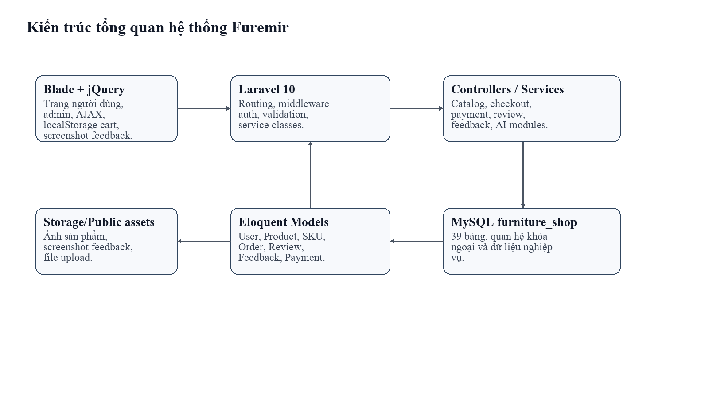

## Thiết kế database

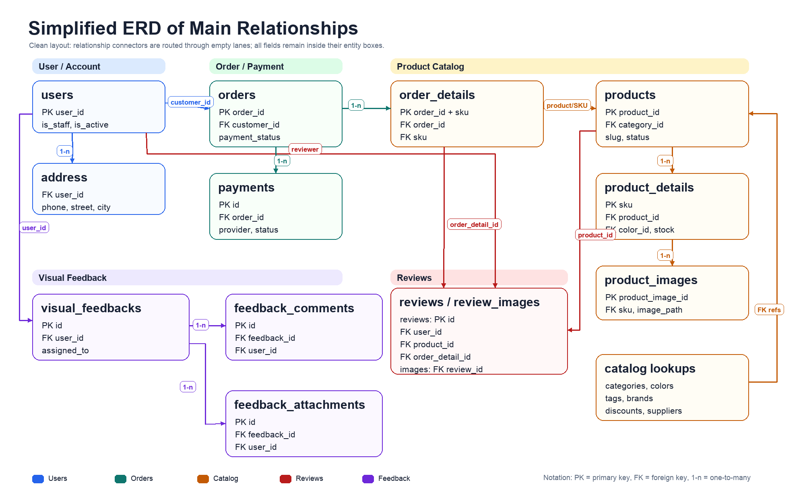

Hệ thống hiện có 39 bảng. Các cụm bảng quan trọng gồm `users/address`, `products/product_details/product_images/categories/colors/tags`, `orders/order_details/payments`, `reviews/review_images`, `visual_feedbacks/comments/attachments/activities`, `wishlist_items`, `room_collections` và các bảng quản trị khác.

# Chương 4: Xây dựng hệ thống

## Môi trường phát triển

| Thành phần | Phiên bản/Ghi chú |
|---|---|
| PHP | 8.2.31 |
| Laravel | 10.x |
| Database | MySQL |
| Frontend | Blade + jQuery |
| Test | PHPUnit, php artisan test |
| Server local | php artisan serve --host=127.0.0.1 --port=8000 |

## Cấu trúc source code

Source code được tổ chức theo chuẩn Laravel: `app/Http/Controllers`, `app/Models`, `app/Services`, `resources/views`, `public/js`, `public/css`, `database/migrations` và `routes/web.php`.

## Luồng checkout

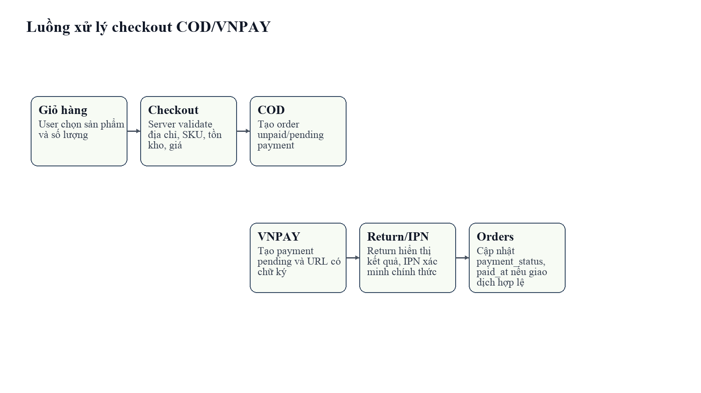

## Đoạn code tiêu biểu

Các đoạn code tiêu biểu nằm trong source thực tế: `app/Services/Payments/VnpayService.php` xử lý chữ ký VNPAY, `public/js/cart.js` xử lý cart/checkout bằng jQuery, `public/js/visual_feedback.js` thu thập selector/screenshot, và các controller admin quản lý dữ liệu.

# Chương 5: Giao diện và kết quả thực hiện

## Hình 1: Trang chủ

- Mục đích: minh họa chức năng Trang chủ.
- Cách sử dụng/kiểm thử: Mở trang chủ và kiểm tra hero/menu/sản phẩm nổi bật.
- Kết quả đạt được: Trang tải đúng và có nội dung/chức năng cần kiểm tra.

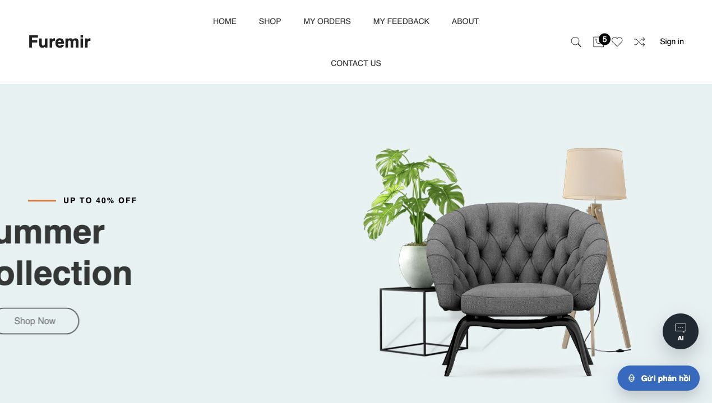

*Hình 1: Trang chủ*

## Hình 2: Menu điều hướng

- Mục đích: minh họa chức năng Menu điều hướng.
- Cách sử dụng/kiểm thử: Quan sát header, menu điều hướng và biểu tượng giỏ hàng.
- Kết quả đạt được: Header hiển thị menu và khu vực giỏ hàng.

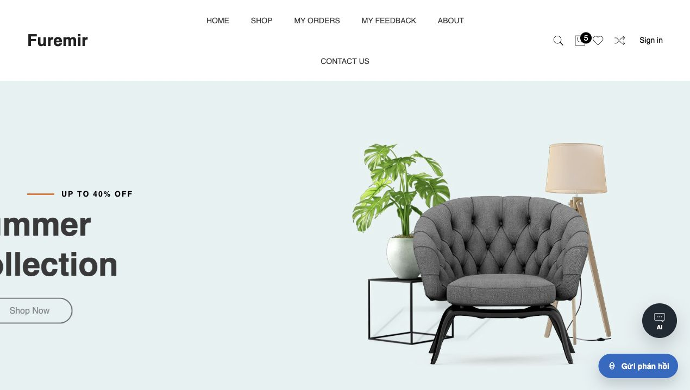

*Hình 2: Menu điều hướng*

## Hình 3: Danh sách sản phẩm

- Mục đích: minh họa chức năng Danh sách sản phẩm.
- Cách sử dụng/kiểm thử: Mở trang shop và kiểm tra lưới sản phẩm.
- Kết quả đạt được: Trang tải đúng và có nội dung/chức năng cần kiểm tra.

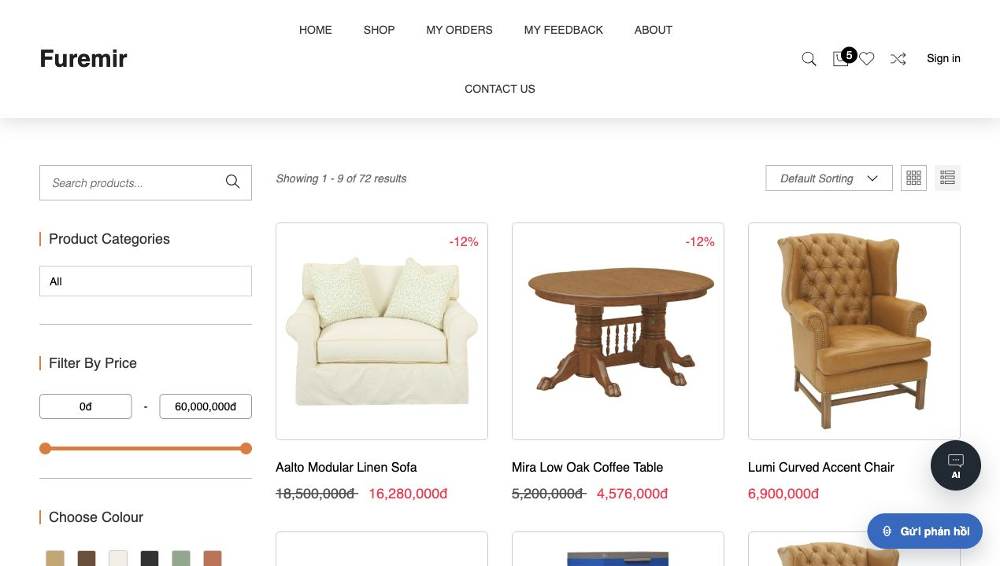

*Hình 3: Danh sách sản phẩm*

## Hình 4: Tìm kiếm sản phẩm

- Mục đích: minh họa chức năng Tìm kiếm sản phẩm.
- Cách sử dụng/kiểm thử: Tìm sản phẩm với từ khóa chair trên trang shop.
- Kết quả đạt được: Trang tải đúng và có nội dung/chức năng cần kiểm tra.

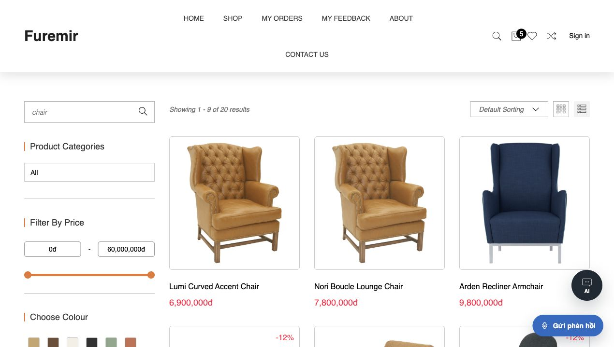

*Hình 4: Tìm kiếm sản phẩm*

## Hình 5: Lọc và sắp xếp sản phẩm

- Mục đích: minh họa chức năng Lọc và sắp xếp sản phẩm.
- Cách sử dụng/kiểm thử: Mở URL shop với tham số lọc giá và sắp xếp tăng dần.
- Kết quả đạt được: Trang tải đúng và có nội dung/chức năng cần kiểm tra.

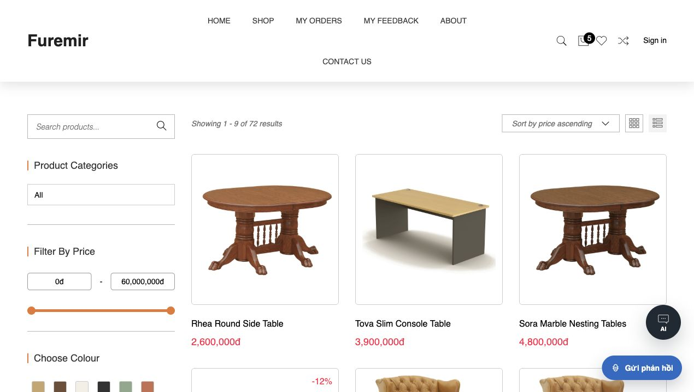

*Hình 5: Lọc và sắp xếp sản phẩm*

## Hình 6: Chi tiết sản phẩm

- Mục đích: minh họa chức năng Chi tiết sản phẩm.
- Cách sử dụng/kiểm thử: Mở trang chi tiết sản phẩm bằng slug SEO.
- Kết quả đạt được: Trang tải đúng và có nội dung/chức năng cần kiểm tra.

*Hình 6: Chi tiết sản phẩm*

## Hình 7: Sản phẩm liên quan và complete the room

- Mục đích: minh họa chức năng Sản phẩm liên quan và complete the room.
- Cách sử dụng/kiểm thử: Kiểm tra khu vực gợi ý ở cuối trang chi tiết sản phẩm.
- Kết quả đạt được: Trang tải đúng và có nội dung/chức năng cần kiểm tra.

*Hình 7: Sản phẩm liên quan và complete the room*

## Hình 8: Đăng nhập

- Mục đích: minh họa chức năng Đăng nhập.
- Cách sử dụng/kiểm thử: Mở trang đăng nhập và kiểm tra form.
- Kết quả đạt được: Trang tải đúng và có nội dung/chức năng cần kiểm tra.

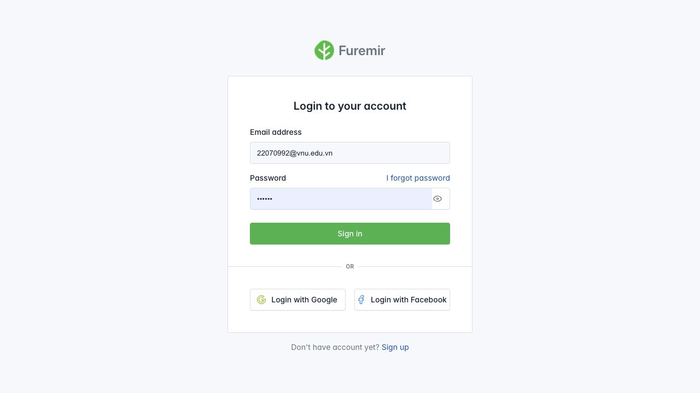

*Hình 8: Đăng nhập*

## Hình 9: Đăng ký

- Mục đích: minh họa chức năng Đăng ký.
- Cách sử dụng/kiểm thử: Mở trang đăng ký và kiểm tra form tạo tài khoản.
- Kết quả đạt được: Trang tải đúng và có nội dung/chức năng cần kiểm tra.

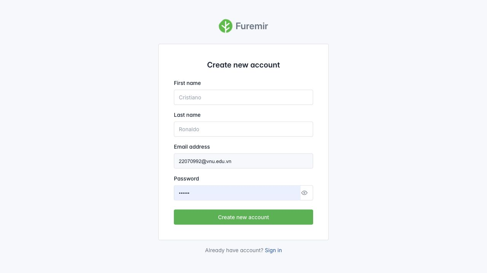

*Hình 9: Đăng ký*

## Hình 10: Đăng nhập người dùng

- Mục đích: minh họa chức năng Đăng nhập người dùng.
- Cách sử dụng/kiểm thử: Mở form đăng nhập, nhập tài khoản demo, submit và mở trang tài khoản.
- Kết quả đạt được: Đăng nhập thành công, trang Account Details hiển thị và menu Logout xuất hiện.

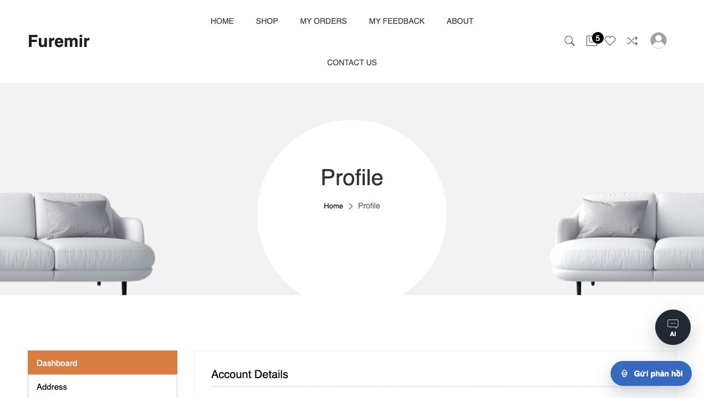

*Hình 10: Đăng nhập người dùng*

## Hình 11: Cập nhật hồ sơ

- Mục đích: minh họa chức năng Cập nhật hồ sơ.
- Cách sử dụng/kiểm thử: Mở trang account và kiểm tra nút Edit profile.
- Kết quả đạt được: Có form Account Details và nút Edit profile.

*Hình 11: Cập nhật hồ sơ*

## Hình 12: Thêm sản phẩm vào giỏ hàng

- Mục đích: minh họa chức năng Thêm sản phẩm vào giỏ hàng.
- Cách sử dụng/kiểm thử: Mở chi tiết sản phẩm, tăng số lượng và bấm Add to cart.
- Kết quả đạt được: Sản phẩm được thêm vào giỏ hàng, icon giỏ hàng cập nhật.

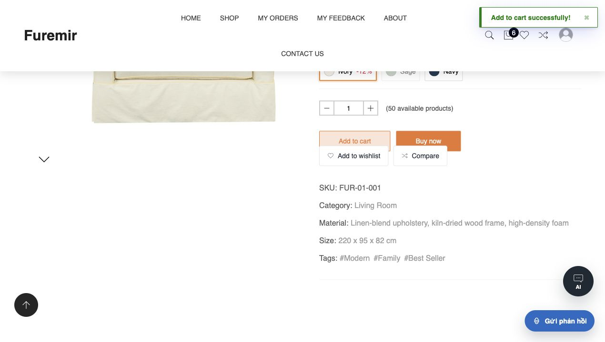

*Hình 12: Thêm sản phẩm vào giỏ hàng*

## Hình 13: Trang giỏ hàng

- Mục đích: minh họa chức năng Trang giỏ hàng.
- Cách sử dụng/kiểm thử: Mở trang cart sau khi thêm sản phẩm.
- Kết quả đạt được: Giỏ hàng hiển thị 6 sản phẩm/dòng hàng.

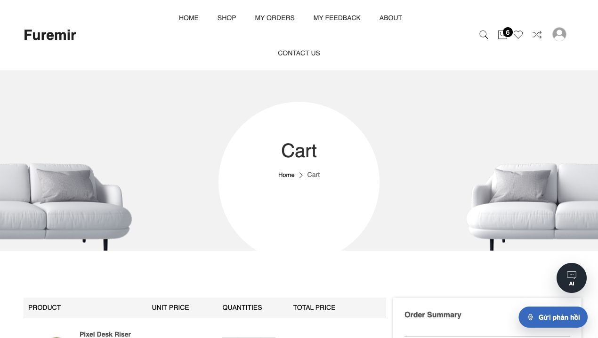

*Hình 13: Trang giỏ hàng*

## Hình 14: Thay đổi số lượng giỏ hàng

- Mục đích: minh họa chức năng Thay đổi số lượng giỏ hàng.
- Cách sử dụng/kiểm thử: Bấm nút tăng số lượng ở dòng sản phẩm đầu tiên.
- Kết quả đạt được: Có ô số lượng và tổng tiền dòng hàng sau thao tác tăng số lượng.

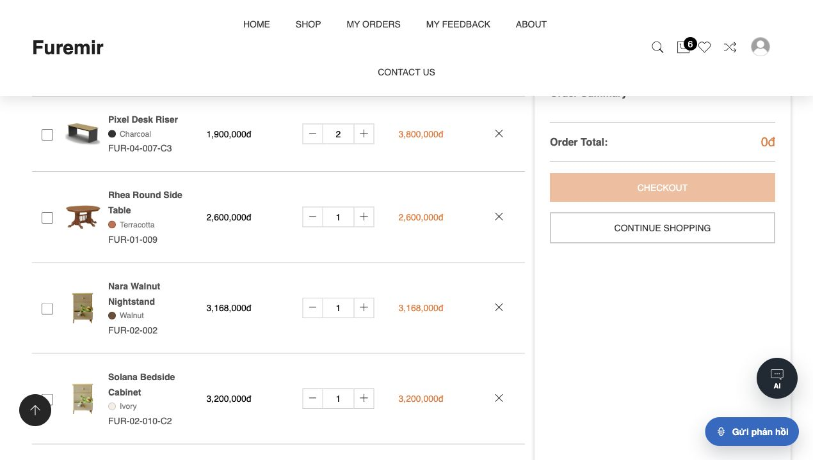

*Hình 14: Thay đổi số lượng giỏ hàng*

## Hình 15: Checkout COD

- Mục đích: minh họa chức năng Checkout COD.
- Cách sử dụng/kiểm thử: Chọn một sản phẩm trong giỏ và bấm Checkout.
- Kết quả đạt được: Trang checkout hiển thị Billing Details, Your Order và phương thức COD/VNPAY.

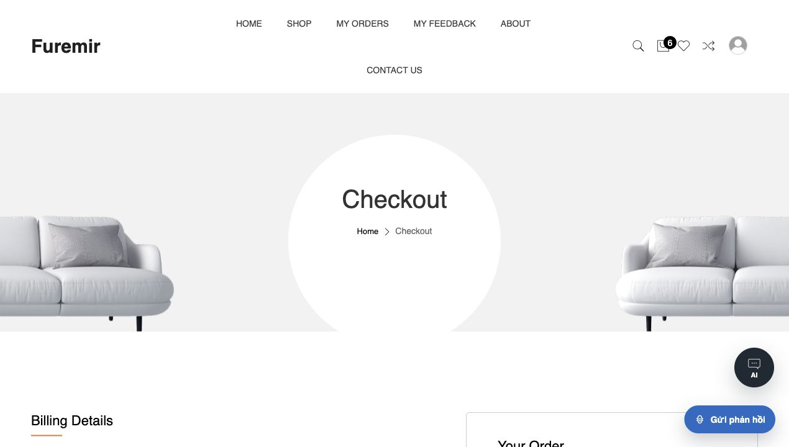

*Hình 15: Checkout COD*

## Hình 16: Đặt hàng thành công

- Mục đích: minh họa chức năng Đặt hàng thành công.
- Cách sử dụng/kiểm thử: Mở trang xác nhận order sau khi submit COD.
- Kết quả đạt được: Trang xác nhận/checkout order hiển thị mã #522 và thông tin đơn.

*Hình 16: Đặt hàng thành công*

## Hình 17: Lịch sử mua hàng

- Mục đích: minh họa chức năng Lịch sử mua hàng.
- Cách sử dụng/kiểm thử: Mở trang My orders sau khi đặt hàng.
- Kết quả đạt được: Trang My orders hiển thị danh sách hoặc khu vực quản lý đơn hàng của user demo.

*Hình 17: Lịch sử mua hàng*

## Hình 18: Chi tiết đơn hàng

- Mục đích: minh họa chức năng Chi tiết đơn hàng.
- Cách sử dụng/kiểm thử: Mở trang chi tiết order vừa tạo.
- Kết quả đạt được: Chi tiết đơn hàng hiển thị trạng thái, địa chỉ, thanh toán, sản phẩm và tổng tiền.

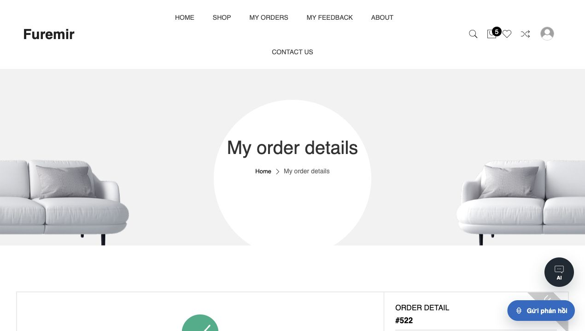

*Hình 18: Chi tiết đơn hàng*

## Hình 19: Xóa sản phẩm khỏi giỏ

- Mục đích: minh họa chức năng Xóa sản phẩm khỏi giỏ.
- Cách sử dụng/kiểm thử: Mở cart, bấm nút xóa ở dòng sản phẩm đầu tiên.
- Kết quả đạt được: Trước khi xóa có 5 dòng, sau thao tác còn 4 dòng.

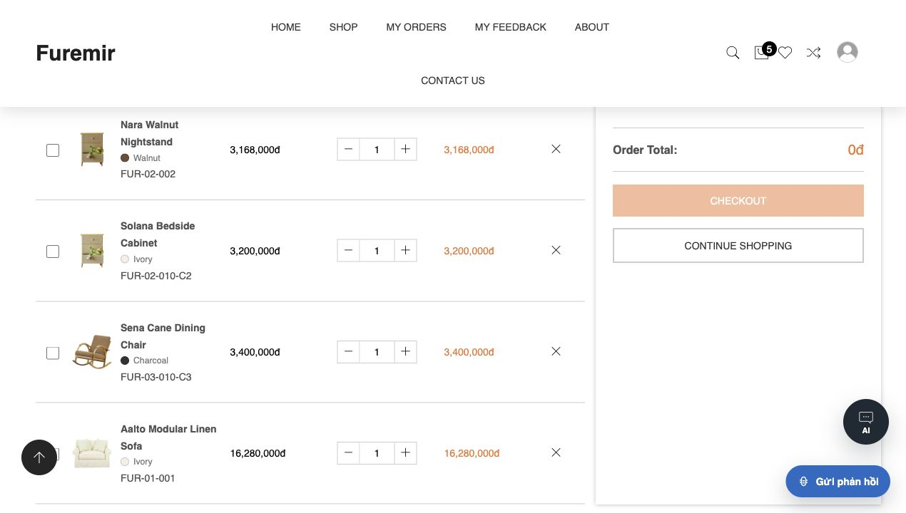

*Hình 19: Xóa sản phẩm khỏi giỏ*

## Hình 20: Wishlist

- Mục đích: minh họa chức năng Wishlist.
- Cách sử dụng/kiểm thử: Thêm sản phẩm vào wishlist từ chi tiết sản phẩm và mở trang wishlist.
- Kết quả đạt được: Trang wishlist hiển thị khu vực danh sách yêu thích và thao tác liên quan.

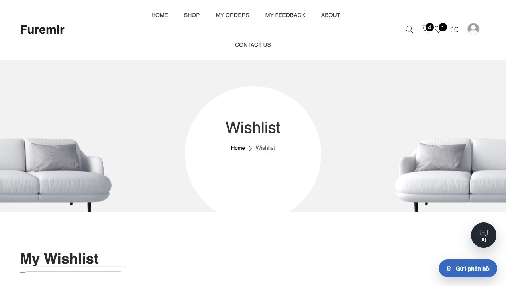

*Hình 20: Wishlist*

## Hình 21: Product Compare

- Mục đích: minh họa chức năng Product Compare.
- Cách sử dụng/kiểm thử: Thêm sản phẩm vào compare và mở trang compare.
- Kết quả đạt được: Trang compare hiển thị bảng/khung so sánh sản phẩm.

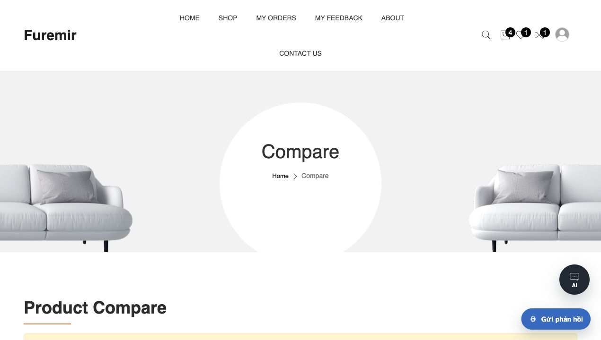

*Hình 21: Product Compare*

## Hình 22: Room Collections

- Mục đích: minh họa chức năng Room Collections.
- Cách sử dụng/kiểm thử: Mở trang danh sách landing page theo phòng.
- Kết quả đạt được: Trang Room Collections hiển thị các collection như Living Room, Bedroom, Dining Room, Office.

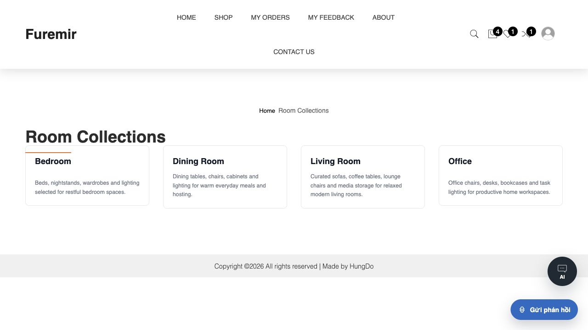

*Hình 22: Room Collections*

## Hình 23: Landing page Living Room

- Mục đích: minh họa chức năng Landing page Living Room.
- Cách sử dụng/kiểm thử: Mở landing page phòng khách.
- Kết quả đạt được: Trang Living Room hiển thị landing page theo phòng với sản phẩm và khu vực gợi ý.

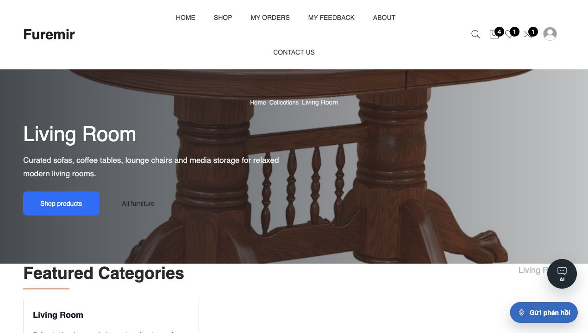

*Hình 23: Landing page Living Room*

## Hình 24: AI Interior Combo Recommendation

- Mục đích: minh họa chức năng AI Interior Combo Recommendation.
- Cách sử dụng/kiểm thử: Mở/focus form AI Interior Combo trên trang chi tiết sản phẩm.
- Kết quả đạt được: Khu vực AI Interior Combo hiển thị trên trang chi tiết sản phẩm.

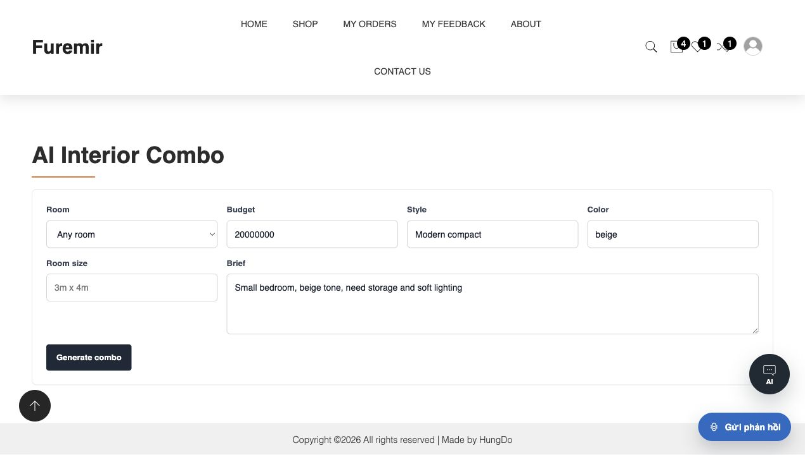

*Hình 24: AI Interior Combo Recommendation*

## Hình 25: AI Chatbox

- Mục đích: minh họa chức năng AI Chatbox.
- Cách sử dụng/kiểm thử: Mở chatbox AI từ nút nổi trên website.
- Kết quả đạt được: Nút AI chatbox tồn tại và khung chat mở được.

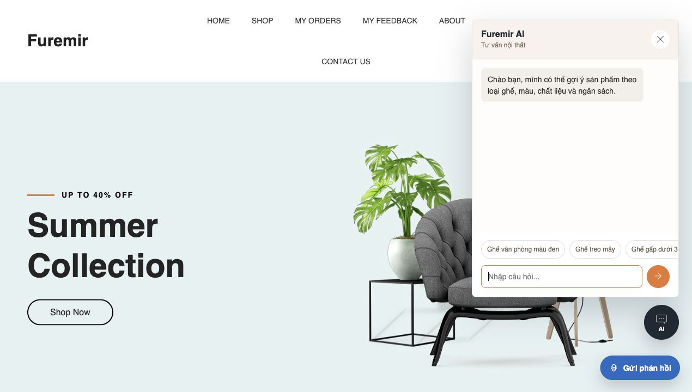

*Hình 25: AI Chatbox*

## Hình 26: Visual Feedback Mode

- Mục đích: minh họa chức năng Visual Feedback Mode.
- Cách sử dụng/kiểm thử: Bấm nút Gửi phản hồi ở góc dưới và kiểm tra chế độ chọn element.
- Kết quả đạt được: Visual Feedback Mode hiển thị cùng nút thoát chế độ feedback.

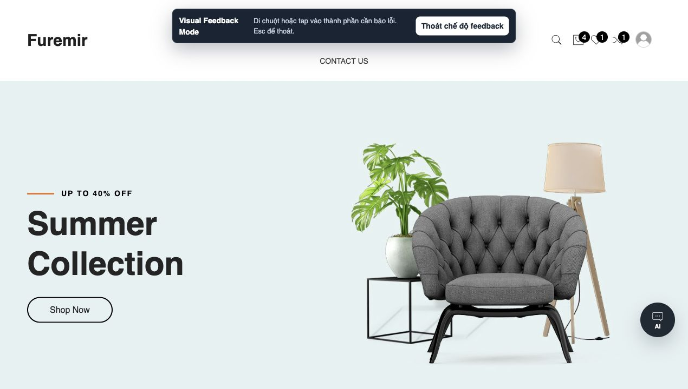

*Hình 26: Visual Feedback Mode*

## Hình 27: Phản hồi của tôi

- Mục đích: minh họa chức năng Phản hồi của tôi.
- Cách sử dụng/kiểm thử: Mở trang danh sách feedback của user.
- Kết quả đạt được: Trang Phản hồi của tôi mở được và hiển thị khu vực quản lý feedback của user.

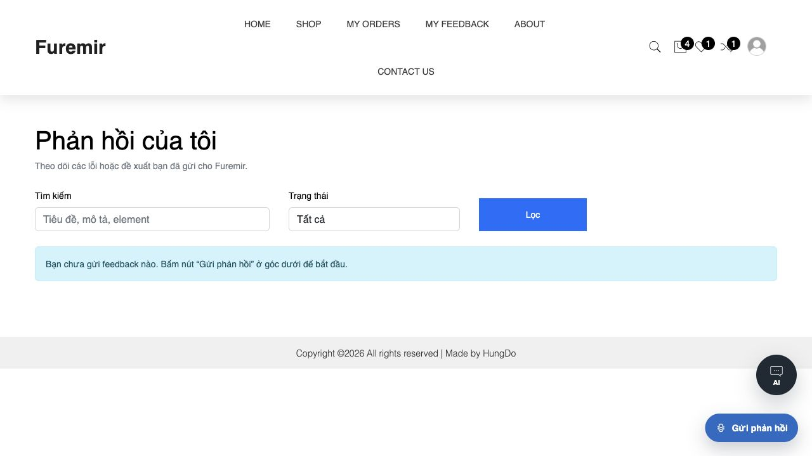

*Hình 27: Phản hồi của tôi*

## Hình 28: VNPAY Return URL

- Mục đích: minh họa chức năng VNPAY Return URL.
- Cách sử dụng/kiểm thử: Mở return URL VNPAY không có query để kiểm tra trang kết quả an toàn.
- Kết quả đạt được: Trang VNPAY return mở được và hiển thị trạng thái phù hợp khi thiếu callback.

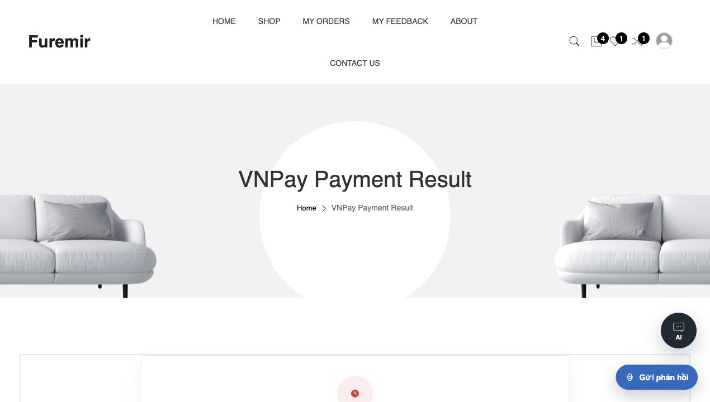

*Hình 28: VNPAY Return URL*

## Hình 29: Admin Dashboard

- Mục đích: minh họa chức năng Admin Dashboard.
- Cách sử dụng/kiểm thử: Đăng nhập admin và mở dashboard.
- Kết quả đạt được: Trang/màn hình quản trị tải đúng và hiển thị nội dung cần kiểm tra.

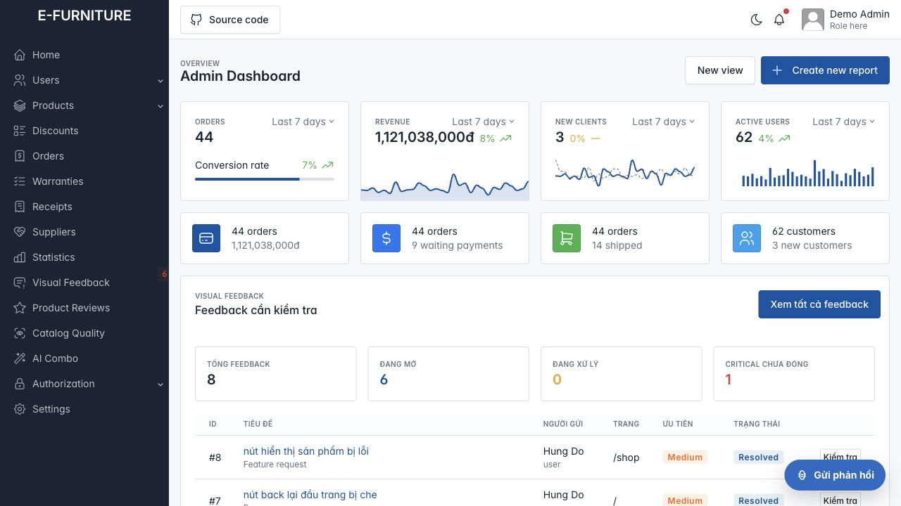

*Hình 29: Admin Dashboard*

## Hình 30: Quản lý sản phẩm

- Mục đích: minh họa chức năng Quản lý sản phẩm.
- Cách sử dụng/kiểm thử: Mở danh sách sản phẩm trong admin.
- Kết quả đạt được: Trang/màn hình quản trị tải đúng và hiển thị nội dung cần kiểm tra.

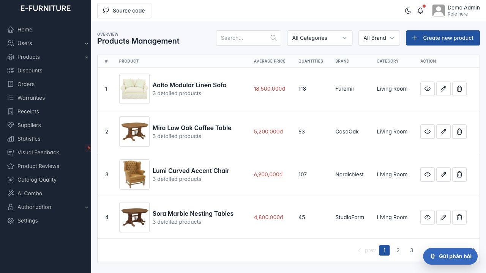

*Hình 30: Quản lý sản phẩm*

## Hình 31: Thêm sản phẩm

- Mục đích: minh họa chức năng Thêm sản phẩm.
- Cách sử dụng/kiểm thử: Mở form thêm sản phẩm.
- Kết quả đạt được: Trang/màn hình quản trị tải đúng và hiển thị nội dung cần kiểm tra.

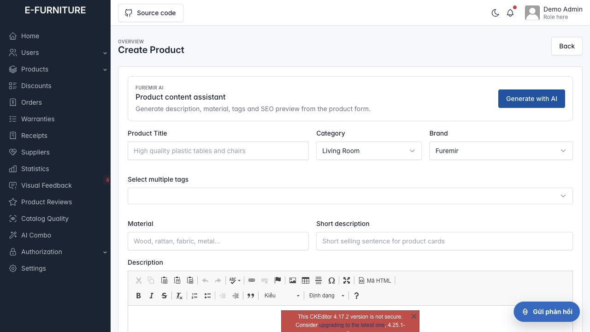

*Hình 31: Thêm sản phẩm*

## Hình 32: Sửa sản phẩm

- Mục đích: minh họa chức năng Sửa sản phẩm.
- Cách sử dụng/kiểm thử: Mở form cập nhật sản phẩm ID 1.
- Kết quả đạt được: Trang/màn hình quản trị tải đúng và hiển thị nội dung cần kiểm tra.

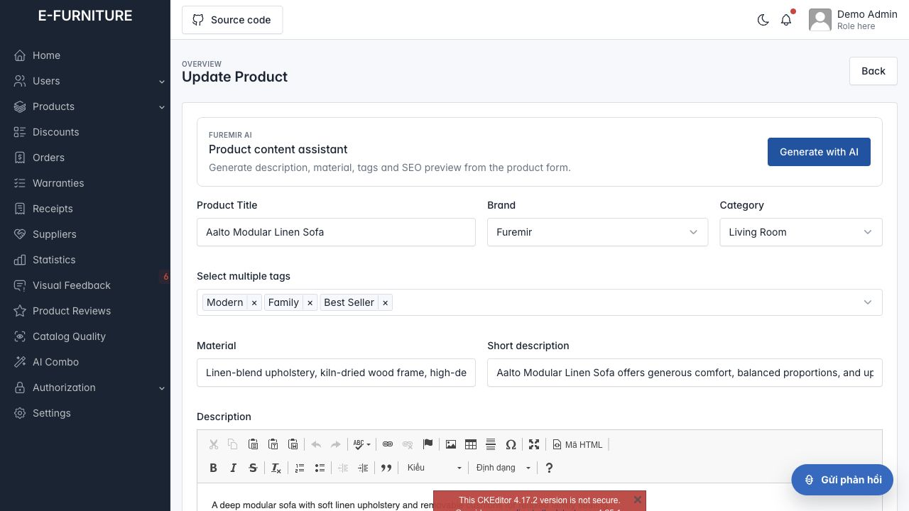

*Hình 32: Sửa sản phẩm*

## Hình 33: Quản lý ảnh, màu và biến thể

- Mục đích: minh họa chức năng Quản lý ảnh, màu và biến thể.
- Cách sử dụng/kiểm thử: Mở chi tiết sản phẩm trong admin để xem biến thể/SKU/ảnh.
- Kết quả đạt được: Trang/màn hình quản trị tải đúng và hiển thị nội dung cần kiểm tra.

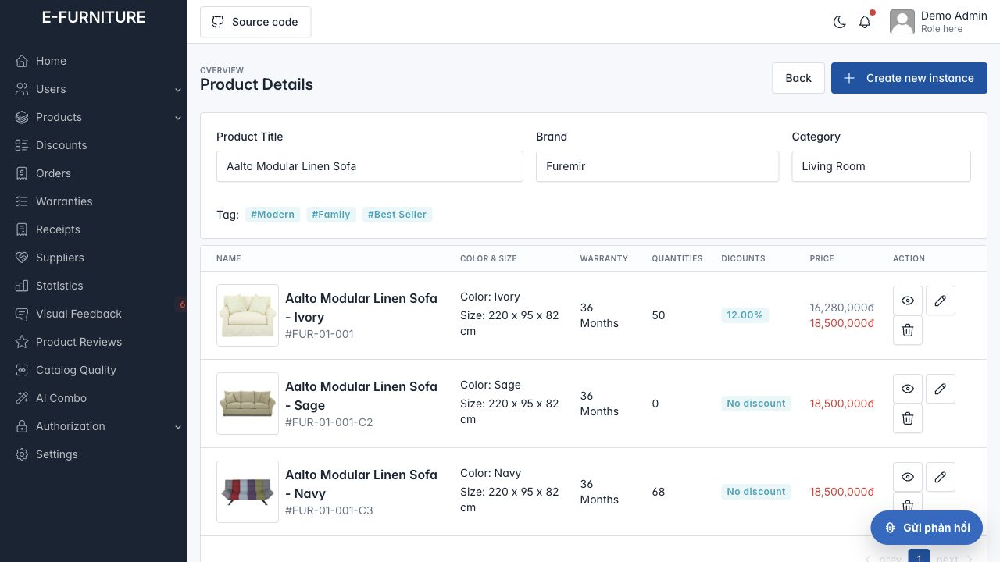

*Hình 33: Quản lý ảnh, màu và biến thể*

## Hình 34: Quản lý danh mục

- Mục đích: minh họa chức năng Quản lý danh mục.
- Cách sử dụng/kiểm thử: Mở trang quản lý danh mục.
- Kết quả đạt được: Trang/màn hình quản trị tải đúng và hiển thị nội dung cần kiểm tra.

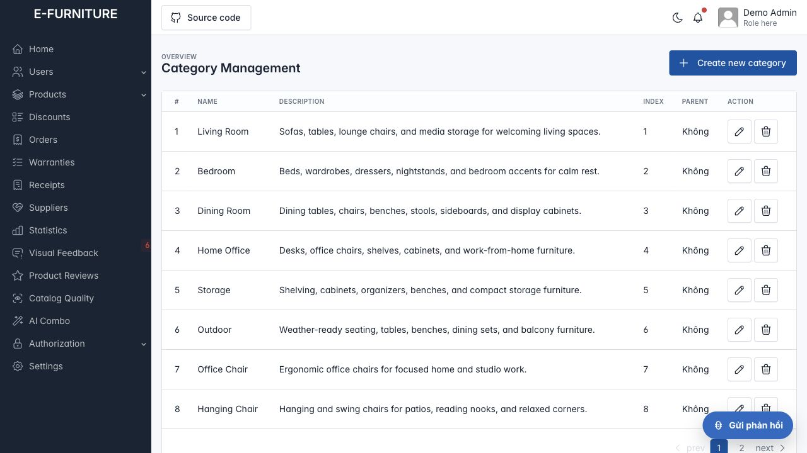

*Hình 34: Quản lý danh mục*

## Hình 35: Quản lý màu sắc

- Mục đích: minh họa chức năng Quản lý màu sắc.
- Cách sử dụng/kiểm thử: Mở trang quản lý màu sắc.
- Kết quả đạt được: Trang/màn hình quản trị tải đúng và hiển thị nội dung cần kiểm tra.

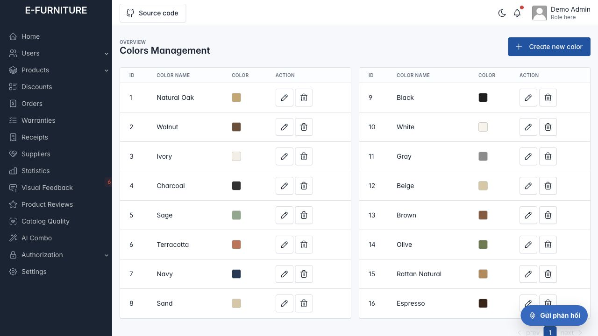

*Hình 35: Quản lý màu sắc*

## Hình 36: Quản lý người dùng/khách hàng

- Mục đích: minh họa chức năng Quản lý người dùng/khách hàng.
- Cách sử dụng/kiểm thử: Mở trang quản lý khách hàng.
- Kết quả đạt được: Trang/màn hình quản trị tải đúng và hiển thị nội dung cần kiểm tra.

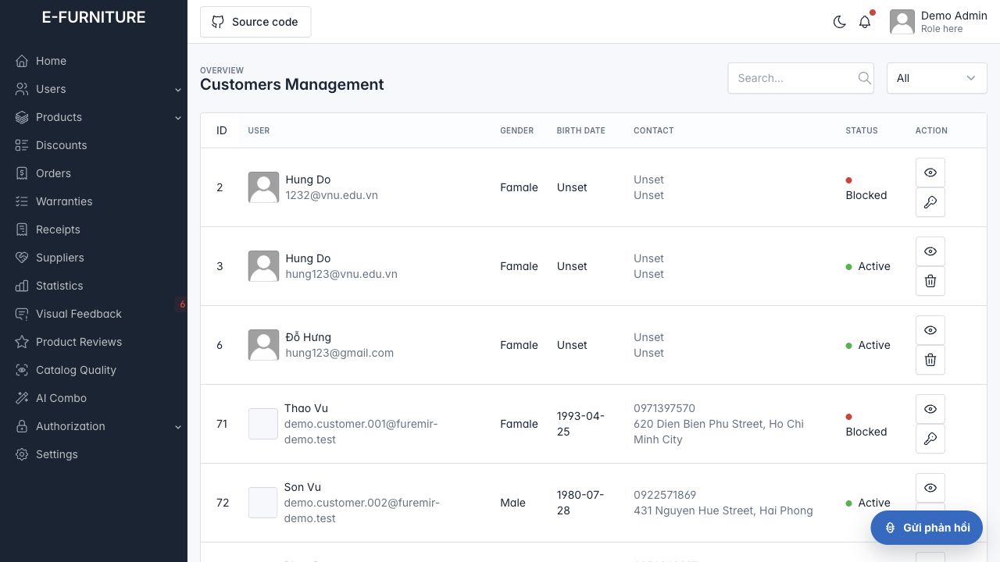

*Hình 36: Quản lý người dùng/khách hàng*

## Hình 37: Quản lý đơn hàng

- Mục đích: minh họa chức năng Quản lý đơn hàng.
- Cách sử dụng/kiểm thử: Mở danh sách đơn hàng.
- Kết quả đạt được: Trang/màn hình quản trị tải đúng và hiển thị nội dung cần kiểm tra.

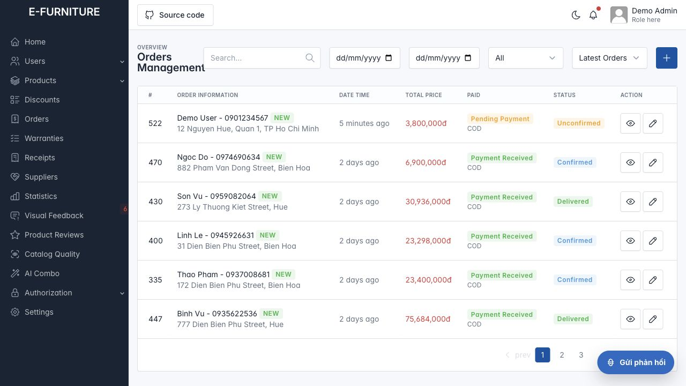

*Hình 37: Quản lý đơn hàng*

## Hình 38: Chi tiết đơn hàng admin

- Mục đích: minh họa chức năng Chi tiết đơn hàng admin.
- Cách sử dụng/kiểm thử: Mở chi tiết order demo trong admin.
- Kết quả đạt được: Trang/màn hình quản trị tải đúng và hiển thị nội dung cần kiểm tra.

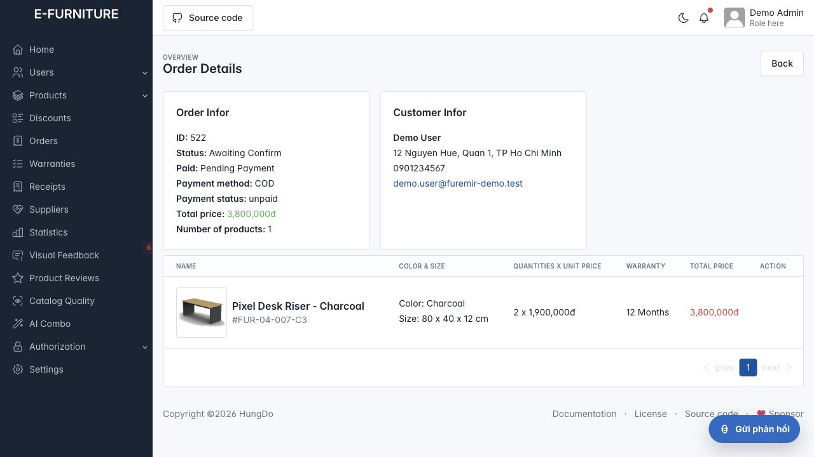

*Hình 38: Chi tiết đơn hàng admin*

## Hình 39: Thống kê admin

- Mục đích: minh họa chức năng Thống kê admin.
- Cách sử dụng/kiểm thử: Mở trang thống kê.
- Kết quả đạt được: Trang/màn hình quản trị tải đúng và hiển thị nội dung cần kiểm tra.

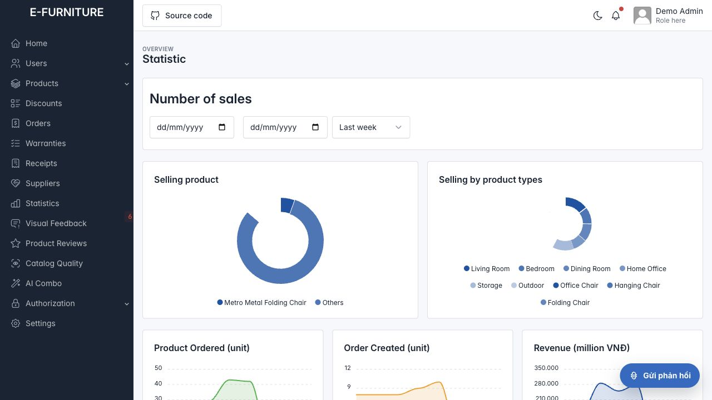

*Hình 39: Thống kê admin*

## Hình 40: Quản lý Visual Feedback

- Mục đích: minh họa chức năng Quản lý Visual Feedback.
- Cách sử dụng/kiểm thử: Mở trang quản lý tất cả visual feedback.
- Kết quả đạt được: Trang/màn hình quản trị tải đúng và hiển thị nội dung cần kiểm tra.

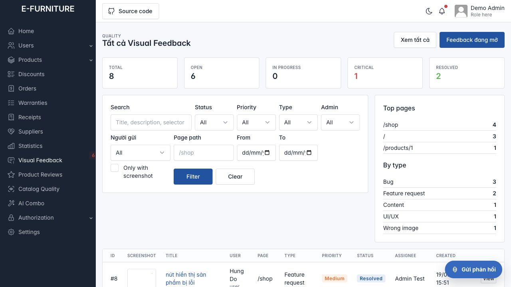

*Hình 40: Quản lý Visual Feedback*

## Hình 41: Chi tiết Visual Feedback và Copy for Codex

- Mục đích: minh họa chức năng Chi tiết Visual Feedback và Copy for Codex.
- Cách sử dụng/kiểm thử: Mở chi tiết feedback ID 6.
- Kết quả đạt được: Trang/màn hình quản trị tải đúng và hiển thị nội dung cần kiểm tra.

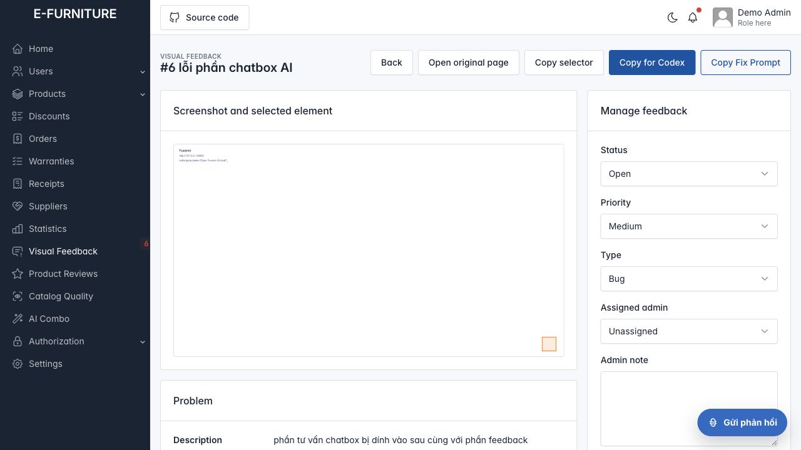

*Hình 41: Chi tiết Visual Feedback và Copy for Codex*

## Hình 42: Quản lý Review

- Mục đích: minh họa chức năng Quản lý Review.
- Cách sử dụng/kiểm thử: Mở trang quản lý đánh giá.
- Kết quả đạt được: Trang/màn hình quản trị tải đúng và hiển thị nội dung cần kiểm tra.

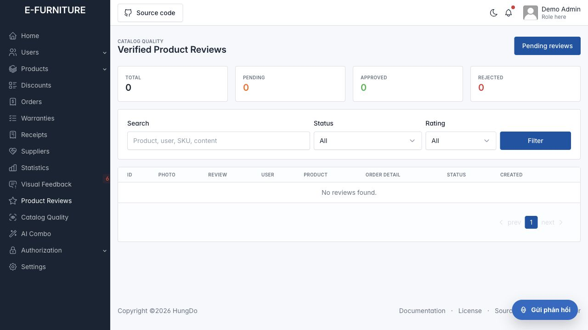

*Hình 42: Quản lý Review*

## Hình 43: AI Catalog Quality Checker

- Mục đích: minh họa chức năng AI Catalog Quality Checker.
- Cách sử dụng/kiểm thử: Mở dashboard kiểm tra chất lượng catalog.
- Kết quả đạt được: Trang/màn hình quản trị tải đúng và hiển thị nội dung cần kiểm tra.

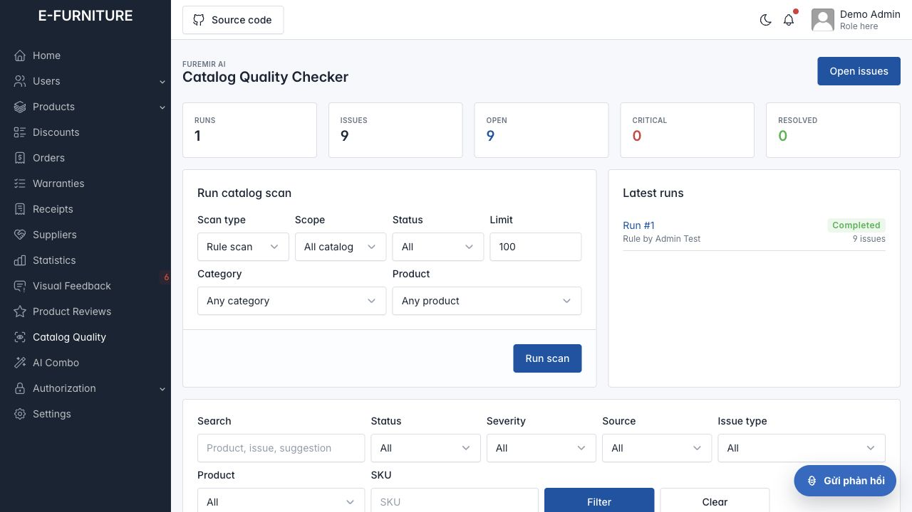

*Hình 43: AI Catalog Quality Checker*

## Hình 44: Cấu hình AI Combo

- Mục đích: minh họa chức năng Cấu hình AI Combo.
- Cách sử dụng/kiểm thử: Mở trang cấu hình AI combo.
- Kết quả đạt được: Trang/màn hình quản trị tải đúng và hiển thị nội dung cần kiểm tra.

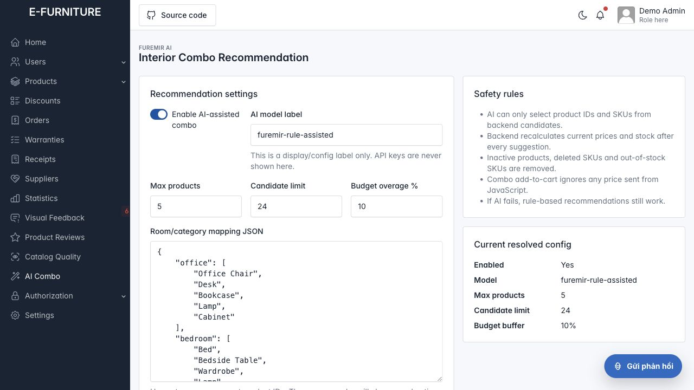

*Hình 44: Cấu hình AI Combo*

## Hình 45: Quản lý mã giảm giá

- Mục đích: minh họa chức năng Quản lý mã giảm giá.
- Cách sử dụng/kiểm thử: Mở trang quản lý discount.
- Kết quả đạt được: Trang/màn hình quản trị tải đúng và hiển thị nội dung cần kiểm tra.

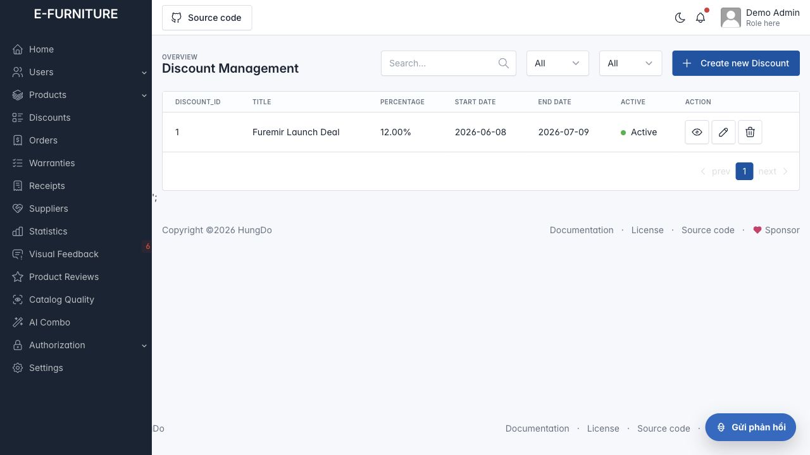

*Hình 45: Quản lý mã giảm giá*

## Hình 46: Cập nhật trạng thái đơn hàng

- Mục đích: minh họa chức năng Cập nhật trạng thái đơn hàng.
- Cách sử dụng/kiểm thử: Mở modal Update trên danh sách đơn hàng, không submit.
- Kết quả đạt được: Modal Update order hiển thị trường Status, thông tin nhận hàng và checkbox Paid.

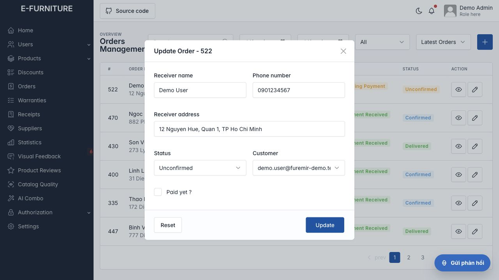

*Hình 46: Cập nhật trạng thái đơn hàng*

# Chương 6: Kiểm thử hệ thống

## Phương pháp kiểm thử

Kiểm thử được thực hiện bằng trình duyệt Chromium trong Codex desktop, viewport 1440x900, đi qua các route và thao tác người dùng thật. Mỗi test có ảnh minh họa sau khi trang tải xong.

## Kết quả tổng hợp

- Tổng test: 46.
- Pass: 46.
- Fail: 0.

Bảng test case đầy đủ nằm trong `functional-test-results.md` và phụ lục của báo cáo.

## Các lỗi/giới hạn phát hiện

- Không kiểm thử giao dịch VNPAY thật do thiếu credential và URL public cho IPN.
- Không có approved review mẫu nên product detail không hiển thị rating thật.
- Không có `package.json`, vì vậy không chạy được build frontend npm/Vite trong project hiện tại.
- Các tính năng AI được kiểm tra giao diện/fallback, chưa xác nhận phản hồi API thật.

# Chương 7: Kết luận và hướng phát triển

## Kết quả đạt được

Project đã có website bán nội thất tương đối đầy đủ: catalog, product detail, cart, checkout, order, admin dashboard, quản lý dữ liệu, review, visual feedback, wishlist, compare, SEO room collections, VNPAY module và các chức năng AI hỗ trợ.

## Điểm mạnh

- Kiến trúc Laravel quen thuộc, dễ bảo trì.
- Dữ liệu sản phẩm có SKU/màu/ảnh, phù hợp sản phẩm nội thất.
- Admin có nhiều màn hình quản lý và công cụ kiểm tra chất lượng.
- Visual Feedback giúp người dùng/admin báo lỗi gắn với element cụ thể.

## Hạn chế

- Cart hiện vẫn phụ thuộc mạnh vào localStorage ở frontend.
- Cần credential thật để kiểm thử VNPAY sandbox end-to-end.
- Cần bổ sung dữ liệu review approved và quy trình email/notification production.

## Hướng phát triển

- Hoàn thiện persistent cart database và abandoned cart dashboard nếu chưa triển khai đầy đủ.
- Tích hợp VNPAY sandbox thật qua ngrok/Laravel Cloud và chuyển production khi có thông tin merchant.
- Bổ sung notification center, order tracking timeline, email transactional.
- Tối ưu SEO, sitemap, metadata và dữ liệu structured data trước khi deploy.

# Tài liệu tham khảo

- Laravel Documentation, https://laravel.com/docs/10.x, truy cập ngày 20/06/2026.
- Spatie Laravel Permission Documentation, https://spatie.be/docs/laravel-permission, truy cập ngày 20/06/2026.
- PHPUnit Documentation, https://docs.phpunit.de/, truy cập ngày 20/06/2026.
- VNPay Sandbox Integration Documentation, tài liệu cấu hình VNPAY Sandbox do cổng thanh toán cung cấp, tham khảo theo yêu cầu tích hợp.

# Phụ lục

## Tài khoản demo

- Admin: `demo.admin@furemir-demo.test` / mật khẩu demo `Demo@123456!`.
- User: `demo.user@furemir-demo.test` / mật khẩu demo `Demo@123456!`.

## Danh sách migration

- `database/migrations/2014_10_12_000000_create_users_table.php`
- `database/migrations/2024_01_20_132651_create_permission_tables.php`
- `database/migrations/2024_03_03_053851_create_address.php`
- `database/migrations/2024_03_03_054328_create_user_verify.php`
- `database/migrations/2024_03_03_054640_create_category.php`
- `database/migrations/2024_03_03_055054_create_brand.php`
- `database/migrations/2024_03_03_055156_create_discount.php`
- `database/migrations/2024_03_03_055515_create_product.php`
- `database/migrations/2024_03_03_060006_create_product_details.php`
- `database/migrations/2024_03_03_060340_create_product_images.php`
- `database/migrations/2024_03_03_060551_create_product_discounts.php`
- `database/migrations/2024_03_03_061431_create_supplier.php`
- `database/migrations/2024_03_03_061643_create_orders.php`
- `database/migrations/2024_03_03_062159_create_order_details.php`
- `database/migrations/2024_03_03_062320_create_warranties.php`
- `database/migrations/2024_03_03_062618_create_receiving_reports.php`
- `database/migrations/2024_03_03_062730_create_receiving_report_details.php`
- `database/migrations/2024_03_03_082524_create_sessions_table.php`
- `database/migrations/2024_03_26_135251_create_colors_table.php`
- `database/migrations/2024_03_26_135437_create_tags_table.php`
- `database/migrations/2024_03_26_140452_modify_detailed_products_table.php`
- `database/migrations/2024_03_26_152348_create_product_tags_table.php`
- `database/migrations/2024_03_31_131053_modify_order_table.php`
- `database/migrations/2024_04_30_154825_modify_product.php`
- `database/migrations/2026_06_10_000001_add_catalog_details_to_products.php`
- `database/migrations/2026_06_17_000002_create_site_visits_table.php`
- `database/migrations/2026_06_19_000001_create_visual_feedback_tables.php`
- `database/migrations/2026_06_20_000001_create_reviews_tables.php`
- `database/migrations/2026_06_20_000002_create_wishlist_items_table.php`
- `database/migrations/2026_06_20_000003_create_catalog_quality_tables.php`
- `database/migrations/2026_06_20_000004_add_seo_and_room_collections.php`
- `database/migrations/2026_06_20_000005_create_ai_combo_settings_table.php`
- `database/migrations/2026_06_20_000006_add_vnpay_payment_support.php`

## Route chính

- `GET|HEAD /payment/vnpay/return - vnpay.return`
- `GET|HEAD /payment/vnpay/ipn - vnpay.ipn`
- `POST /feedback - feedback.store`
- `GET|HEAD /feedback/{feedback}/screenshot - feedback.screenshot`
- `GET|HEAD /feedback-attachments/{attachment} - feedback.attachment`
- `GET|HEAD // - user`
- `GET|HEAD /shop - shop`
- `GET|HEAD /collections - collections.index`
- `GET|HEAD /collections/{collection} - collections.show`
- `GET|HEAD /cart - cart`
- `GET|HEAD /compare - compare.index`
- `GET|HEAD /compare/status - compare.status`
- `POST /compare - compare.store`
- `DELETE /compare/{product_id} - compare.destroy`
- `DELETE /compare - compare.clear`
- `POST /wishlist - wishlist.store`
- `DELETE /wishlist/{product_id} - wishlist.destroy`
- `GET|HEAD /checkout - checkout`
- `POST /ai-interior-combo/recommend - ai-interior-combo.recommend`
- `POST /ai-interior-combo/cart-items - ai-interior-combo.cart_items`
- `GET|HEAD /cart/async`
- `POST /checkout - checkout`
- `POST /checkout/vnpay - vnpay.create`
- `GET|HEAD /checkout/{order_id} - checkout.handle`
- `GET|HEAD /myorders - my_orders`
- `GET|HEAD /myorders/{order_id} - my_detailed_order`
- `PATCH /myorders/{order_id}`
- `GET|HEAD /wishlist - wishlist.index`
- `GET|HEAD /admin - admin`
- `GET|HEAD /admin/dashboard/orders-statistic`
- `GET|HEAD /admin/ai/dashboard-summary - admin.ai.dashboard_summary`
- `GET|HEAD /admin/ai/product-content - admin.ai.product_content`
- `GET|HEAD /admin/ai-combo - admin.ai-combo.index`
- `PATCH /admin/ai-combo - admin.ai-combo.update`
- `GET|HEAD /admin/feedback - admin.feedback.index`
- `GET|HEAD /admin/feedback/{feedback} - admin.feedback.show`
- `PATCH /admin/feedback/{feedback} - admin.feedback.update`
- `POST /admin/feedback/{feedback}/comments - admin.feedback.comments.store`
- `DELETE /admin/feedback/{feedback} - admin.feedback.destroy`
- `GET|HEAD /admin/reviews - admin.reviews.index`
- `GET|HEAD /admin/reviews/{review} - admin.reviews.show`
- `PATCH /admin/reviews/{review} - admin.reviews.update`
- `GET|HEAD /admin/catalog-quality - admin.catalog-quality.index`
- `POST /admin/catalog-quality/runs - admin.catalog-quality.runs.store`
- `GET|HEAD /admin/catalog-quality/runs/{run} - admin.catalog-quality.runs.show`
- `PATCH /admin/catalog-quality/issues/{issue} - admin.catalog-quality.issues.update`
- `POST /admin/catalog-quality/issues/{issue}/apply - admin.catalog-quality.issues.apply`
- `POST /admin/catalog-quality/products/{product}/rescan - admin.catalog-quality.products.rescan`
- `GET|HEAD /admin/employee`
- `GET|HEAD /admin/employee/pagination`
- `GET|HEAD /admin/employee/{user_id}`
- `GET|HEAD /admin/employee/{user_id}/details`
- `GET|HEAD /admin/customers`
- `GET|HEAD /admin/customers/{user_id}/details`
- `GET|HEAD /admin/customers/pagination`
- `POST /admin/employee/create`
- `POST /admin/employee/update`
- `GET|HEAD /admin/users/{user_id}/ban`
- `GET|HEAD /admin/users/{user_id}/unban`
- `GET|HEAD /admin/brands - brands.search`
- `GET|HEAD /admin/brands/pagination - brands.search`
- `POST /admin/brands/create - brands.create`
- `PUT /admin/brands/update - brands.edit`
- `DELETE /admin/brands/{brand_id}/delete - brands.delete`
- `GET|HEAD /admin/categories`
- `GET|HEAD /admin/categories/getall`
- `GET|HEAD /admin/categories/{category_id}`
- `POST /admin/categories - categories.create`
- `PATCH /admin/categories/{category_id} - categories.update`
- `DELETE /admin/categories/{category_id} - categories.delete`
- `GET|HEAD /admin/suppliers - suppliers.index`
- `GET|HEAD /admin/suppliers/pagination - suppliers.search`
- `POST /admin/suppliers/create`
- `PUT /admin/suppliers/update - suppliers.edit`
- `DELETE /admin/suppliers/{supplier_id}/delete - suppliers.delete`
- `GET|HEAD /admin/orders`
- `GET|HEAD /admin/orders/search`
- `GET|HEAD /admin/orders/{order_id} - orders.details`
- `GET|HEAD /admin/warranties`
- `GET|HEAD /admin/warranties/search - warranty.search`
- `GET|HEAD /admin/warranties/{warranty_id} - warranties.details`
- `POST /admin/orders`
- `POST /admin/orders/{order_id}`
- `POST /admin/warranties/create`
- `PUT /admin/orders/{order_id}`
- `PUT /admin/warranties/{warranty_id}`
- `DELETE /admin/orders/{order_id}/delete/{sku}`
- `GET|HEAD /admin/colors - colors.index`
- `GET|HEAD /admin/tags - tags.index`
- `POST /admin/colors - colors.create`
- `POST /admin/tags - tags.create`
- `PATCH /admin/colors/{color_id} - colors.update`
- `PATCH /admin/tags/{tag_id} - tags.update`
- `DELETE /admin/colors/{color_id} - colors.delete`
- `DELETE /admin/tags/{tag_id} - tags.delete`
- `GET|HEAD /admin/products/detailed_products - products.detailed_products.search`
- `GET|HEAD /admin/products/create - products.create_ui`
- `POST /admin/products/create - products.create`
- `GET|HEAD /admin/products/{product_id}/create - products.create_detailed_product_ui`
- `POST /admin/products/{product_id}/create - products.create_detailed_product`
- `GET|HEAD /admin/products/{product_id}/update - products.update_ui`
- `PATCH /admin/products/{product_id}/update - products.update`
- `GET|HEAD /admin/products/{product_id}/{sku}/update - products.update_detailed_product_ui`
- `PATCH /admin/products/{product_id}/{sku}/update - products.update_detailed_product`
- `DELETE /admin/products/{product_id} - products.delete`
- `DELETE /admin/products/delete/{sku} - products.delete_detailed_product`
- `GET|HEAD /admin/products - products.index`
- `GET|HEAD /admin/products/pagination - products.pagination`
- `GET|HEAD /admin/products/{product_id} - products.details`
- `GET|HEAD /admin/products/{product_id}/{sku} - products.detailed_product_details`
- `GET|HEAD /admin/receipts`
- `GET|HEAD /admin/receipts/pagination`
- `GET|HEAD /admin/receipts/{receipt_id} - receipts.details`
- `POST /admin/receipts/create`
- `POST /admin/receipts/{receipt_id}`
- `DELETE /admin/receipts/{receipt_id}/delete/{sku}`
- `GET|HEAD /admin/discounts`
- `GET|HEAD /admin/discounts/{discount_id} - discount.detail`
- `GET|HEAD /admin/discount/{discount_id}/get_products_not_in_discount`
- `POST /admin/discounts`
